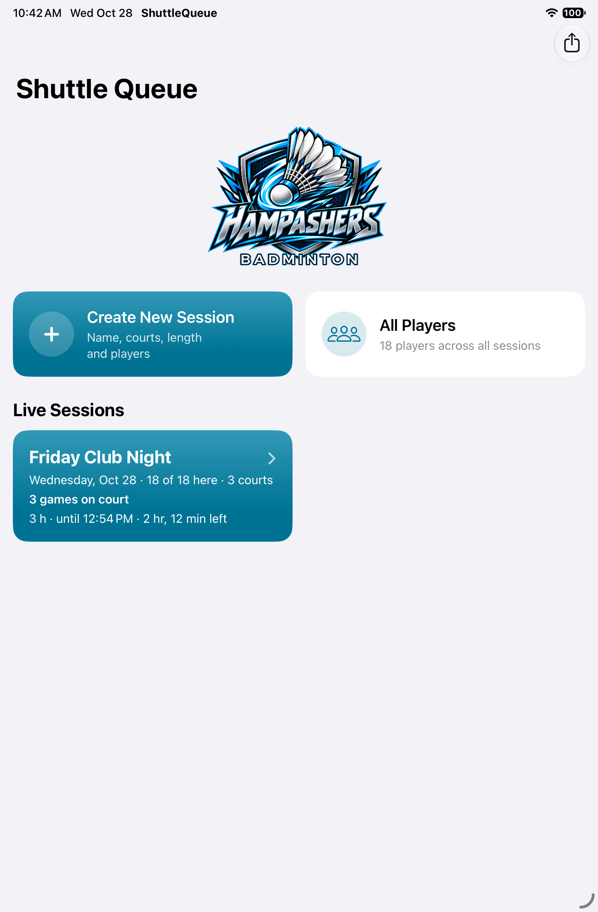
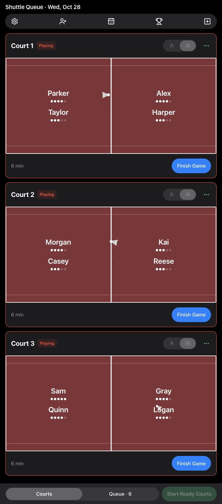
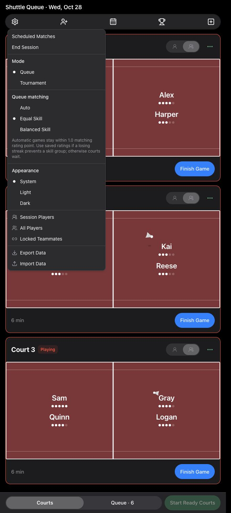

# Shuttle Queue 🏸

Run a badminton club night without juggling a paper queue. Shuttle Queue manages courts, player turns, balanced matches, ratings, and tournaments on iPad and the web.

[Open the web app](https://hampashers.netlify.app) · [Web app source](https://github.com/blueratdota/badminton-queue-webapp) · [Full playing rules](RULES.md) · [MIT license](LICENSE)

## Screenshots

Actual app screens using a fictional demo roster. The web app adapts to phones and tablets; the native app is designed for iPad.

| Native iPad app | Web courts | Queue matching settings |
| --- | --- | --- |
|  |  |  |

## Features

- **Multiple courts:** run singles and doubles together, start ready courts, and see each court's next game without booking a player twice.
- **Fair player rotation:** counted games and rest order guide selection, with support for arrivals, sitting out, returning players, and organiser adjustments.
- **Three matching modes:** choose Auto, Equal Skill, or Balanced Skill for each session; copied sessions retain their setting.
- **Control when you need it:** shuffle a lineup, keep one side, replace a player, select a manual lineup, or lock regular teammates together.
- **Scheduled matches:** reserve exact teams after their first game, with court assignment, postponement, cancellation, and queue-priority protections.
- **Ratings and standings:** Elo-style rating changes, temporary win/loss streak adjustments, match history, result corrections, and standings.
- **Tournament play:** round robin followed by a double-elimination bracket, for singles or doubles.
- **Session management:** create, end, reopen, and revisit sessions; maintain a player registry across nights.
- **Local data:** the iPad saves on-device; the hosted web app saves in the current browser and supports JSON export/import.
- **Adaptive interface:** phone navigation, tablet layouts, light/dark appearance, and court rally animations that respect Reduce Motion.

## Queue matching

Choose **Settings → Queue matching** while in queue mode.

| Mode | How it selects games |
| --- | --- |
| **Auto — default** | Uses the original queue logic: prefer a 1.0-point skill range, then 1.5, then mixed balanced teams, with game-count and rest protections. Older saves default to Auto. |
| **Equal Skill** | Keeps automatic games within **1.0 matching rating point** from lowest to highest. If a losing-streak penalty leaves a player without a compatible group in the active roster, use their current saved rating instead. A court waits when no legal group fits. |
| **Balanced Skill** | Prioritizes queue turns and balances teams, allowing mixed skill levels without preferring a narrow rating range. |

Matching ratings are capped at **5.0**. The losing-streak fallback applies only to Equal Skill; it changes neither saved ratings nor streak history. Game-count, rest, teammate-lock, and rematch protections still apply. Manual lineups and exact scheduled games retain their overrides. Strict matching does not guarantee a maximum wait. See [RULES.md](RULES.md) for the complete behavior and tunable values.

## Use the app

### Web

Open **[hampashers.netlify.app](https://hampashers.netlify.app)** in a current browser. Choose courts, add players, select a matching mode, and start ready games. Finish each game to record its winner and return players to the queue.

Use **Settings → Export Data** to back up a browser's sessions. **Import Data** adds exported sessions and replaces sessions with the same ID. Each browser and device has its own data; iPad and web do not sync automatically. The iPad's JSON export can be imported into the hosted web app.

The maintained React frontend lives in the [web app repository](https://github.com/blueratdota/badminton-queue-webapp). This repository also includes a standalone HTML version:

```sh
python3 -m http.server 8080 --directory web
# Open http://localhost:8080
```

Keep `web/logo.png` and `web/app-icon.png` alongside its HTML file.

### Native iPad app

Requires **iPadOS 17 or later**, macOS, and an Xcode installation with an appropriate iOS SDK. The app uses SwiftUI, Swift 5 language mode, and no third-party dependencies.

1. Clone this repository and open `ShuttleQueue.xcodeproj`.
2. Select the **ShuttleQueue** scheme and your simulator or iPad.
3. For a physical device, select your development team under Signing & Capabilities.
4. Build and run. Use an optimized **Release** build for club nights; Debug builds include extensive self-checks and are slower at matching.

```sh
# Replace the destination name with an installed iPad simulator.
xcodebuild -project ShuttleQueue.xcodeproj -scheme ShuttleQueue \
  -configuration Debug -destination 'platform=iOS Simulator,name=iPad mini (A17 Pro)' \
  -derivedDataPath build/sim build

# Signed Release build for a physical iPad.
xcodebuild -project ShuttleQueue.xcodeproj -scheme ShuttleQueue \
  -configuration Release -destination 'generic/platform=iOS' \
  -derivedDataPath build/dev -allowProvisioningUpdates build
```

Free Apple development signing expires after seven days. The app shows its signing expiry in **Settings → This iPad copy**; reinstall a freshly signed build to renew it. Updating the same app preserves its saved sessions.

## Development and checks

| Location | Purpose |
| --- | --- |
| `ShuttleQueue/ShuttleQueueApp.swift` | Models, persistence, queue matching, ratings, self-checks, and simulation |
| `ShuttleQueue/ContentView.swift` | Native session, court, player, and settings UI |
| `ShuttleQueue/Tournament.swift` | Tournament model, matching, and views |
| `web/index.html` | Standalone browser app and matching engine |
| `tools/` | Browser self-checks, deterministic replays, and simulation diagnostics |
| `RULES.md` | Organiser-facing specification and tunable rules |

Run the browser checks with Node.js:

```sh
node tools/web-check.js web/index.html
node tools/scheduled-check.js web/index.html
node tools/queue-simplified-check.js web/index.html

# Use an exported session file kept outside version control.
node tools/web-sim.js web/index.html /path/to/session.json \
  --courts 3 --minutes 180 --runs 30 --queue-matching equalSkill
```

The simulator runs native assert-based self-checks on every Debug launch. Launch with `-simulate` for virtual nights, or use `-parity -courts 3 -queue-matching equalSkill` and the browser replay's `--parity` option to compare native/web matching. Simulation input is `Documents/sim-input.json`, falling back to saved sessions.

When changing behavior or a tuning constant, update `RULES.md` and keep native and web matching consistent. Do not commit player exports, device backups, signing material, or build output.

## License

[MIT](LICENSE) © 2026 blueratdota. Third-party dependencies in the separate web app retain their own licenses.
